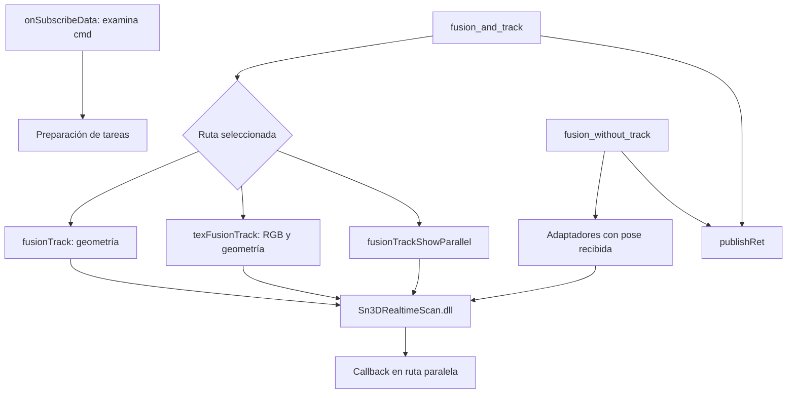

# EXStar: del comando de escaneo al motor de tracking

Fecha: 2026-10-15. Cuarta tanda de REA/Ghidra. Continúa [Escaneo de objetos](EXSTAR_OBJECT_SCAN.md) y conserva el alcance del roadmap.

## Resultado y límites

Se analizaron los receptores y adaptadores de `fusion_and_track` y `fusion_without_track` en `Sn3DAlgorithmWrapper.dll`. Hay rutas geométricas, con textura y paralelas que delegan el cálculo en funciones importadas de `Sn3DRealtimeScan.dll`.

Se resolvió una pregunta de la tanda anterior: **`isNeed` puede escribirse de vuelta después de procesar el frame**. En una ruta de textura se observa explícitamente la copia del valor devuelto por el motor al booleano compartido. En rutas geométricas se pasa su dirección a la biblioteca externa; no se ha inspeccionado allí cuándo lo modifica.

También se localizaron condiciones de rechazo por velocidad, comprobaciones previas y códigos de resultado concretos. Esto no equivale a haber recuperado la relocalización de EXStar: los algoritmos dentro de la biblioteca de cálculo siguen pendientes.

## Identidad de la evidencia

- Original analizado: `C:\Shining3d\EXStar\Sn3DAlgorithmWrapper.dll`, 1772024 bytes.
- SHA-256 comprobado al abrir y al terminar: `5ba900e2727215774e32857cd34625fba92562d5b1ec6aa88985ff2d0a15068b`.
- REA 6.4.0, Ghidra 12.1.4, JDK 21; heap de Ghidra de 2 GB y plazo de arranque de 900 segundos.
- 27 registros de evidencia REA, de los cuales 20 son descompilaciones exitosas.
- Direcciones virtuales de la imagen estática; no direcciones observadas en ejecución.

El pseudocódigo conserva limitaciones de tipos inferidos, prototipos incompletos en algunos sitios de llamada y despacho indirecto. No se ejecutó EXStar. El análisis no demuestra qué combinación de modos selecciona un EINSTAR real durante una sesión.

## Pasos realizados

1. Consultar el inventario XML existente: asocia `SpeckleTrackAndFusionAlgManager` y `SpeckleNorigidTrackAndFusionAlgManager` a `Sn3DAlgorithmWrapper`. El tema IR declara al gestor entre sus suscriptores; esto orienta la investigación, sin probar ejecución.
2. Ampliar el helper local con la operación de lectura `search_strings`, verificar su esquema anunciado por el servidor y abrir la DLL original.
3. Buscar las dos operaciones, `isNeed` y términos de recuperación entre las cadenas definidas por Ghidra.
4. Inspeccionar adicionalmente las tablas PE32+ de importación y exportación mediante lecturas locales con Python `struct`. Los registros auxiliares son `alg-wrapper-pe-imports.json` y `alg-wrapper-selected-exports.json`; no son Evidence de REA. La inspección de importaciones no incluye cargas dinámicas ni importaciones diferidas.
5. Descompilar los dos métodos exportados y seguir sus llamadas internas hasta los adaptadores de las funciones importadas.
6. Examinar `onSubscribeData`, la preparación de tareas, `publishRet` y el callback paralelo para distinguir solicitud, ejecución y resultado.
7. Conservar un snapshot de evidencia, cerrar la sesión y comprobar el hash original y la ausencia de procesos propios de REA/Ghidra.

## Mapa de llamadas observado

El diagrama separa la preparación de tareas de los métodos: no se reconstruyeron todos los enlaces de tablas virtuales ni el bucle trabajador. Los invocadores `0x1800a4cd0` y `0x1800a4c30` sí llaman directamente a los dos métodos respectivos. La preparación de la tarea de tracking en `0x180097a50` crea un `packaged_task`, lo introduce en una estructura protegida por mutex y notifica una condición.

| Procedimiento | Dirección | Observación |
|---|---|---|
| `onSubscribeData` | `0x1800c6870` | Compara `cmd` con ambas operaciones, además de `pause`, `reset`, `track_current_frame` y otras; selecciona auxiliares de tareas |
| `fusion_and_track` | `0x1800b35d0` | Comprueba handle/nube, contempla una comprobación de velocidad y selecciona rutas de ejecución |
| `fusion_without_track` | `0x1800b4a00` | Usa pose recibida y tiene ramas de escaneo, textura y procesamiento adicional |
| `fusionTrack` | `0x1800af310` | Prepara seguimiento geométrico y una ruta separada con recorte por plano |
| `texFusionTrack` | `0x1800d5a30` | Construye datos de color y geometría y utiliza la transformación de cámara |
| `fusionTrackShowParallel` | `0x1800b0750` | Construye datos compartidos para seguimiento, fusión y presentación |
| `publishRet` | `0x1800c8b30` | Empaqueta código de resultado, timestamp y datos adicionales |

La selección normal en `fusion_and_track` da prioridad a `isTexTrack`; en su ausencia, si `useParallel` es verdadero, toma la ruta paralela; en caso contrario llama a `fusionTrack`. Esto describe esa rama, no todos los caminos de la función.

## Qué se delega al motor

En `0x1800def10`, con handle válido, se observa esta selección:

| Condición | Llamada importada |
|---|---|
| `useSpeed=false`, `isE10=false` | `Sn3DAlgorithm::fusion_and_track`, variante `PointImage` |
| `useSpeed=false`, `isE10=true` | `Sn3DAlgorithm::fusion_and_track_E10` |
| `useSpeed=true` | Configura umbrales y llama a `fusion_and_track_with_speed_limit_has_feature_align_logic` |

La última llamada recibe también un valor de `clock()` y un parámetro entero por referencia. El nombre contiene `feature_align_logic`, pero aún no se conoce el algoritmo ni sus condiciones de activación. No permite afirmar que se haya localizado una relocalización global robusta.

En la ruta con plano, `0x1800e6610` llama a `track_current_frame` o `track_current_frame_E10`, recibiendo una `RigidMatrix`; cuando el resultado permite continuar, el llamador recorta la nube y pasa a fusión con pose. En `0x1800df520` y `0x1800de890` se observan llamadas a `fusion_without_track` con esa pose y el booleano por referencia.

**Precaución de interpretación:** las convenciones de retorno no son uniformes. Algunas llamadas del motor devuelven verdadero/no cero como éxito y el adaptador lo convierte a código cero. `track_current_frame` devuelve un `RetVal` cuyo cero se conserva como éxito en su adaptador. No se debe interpretar un entero sin conocer la función de origen.

## Seguimiento del booleano compartido

La tercera tanda mostró su creación inicial en `scan_Object`. Ahora se observa:

1. `fusionTrack` extrae el puntero de `isNeed` y lo pasa al adaptador geométrico como `bool*`.
2. `fusion_without_track`, en la rama geométrica de escaneo, también pasa ese puntero hasta la función importada de fusión.
3. `texFusionTrack` extrae el puntero y lo entrega a `0x1800dedc0`. Este auxiliar copia el byte a una estructura local, llama a la variante con `ColorAndPoint` y escribe el byte resultante de vuelta al puntero original **antes de evaluar el retorno de éxito/fallo**.
4. El callback paralelo prepara un campo `isNeed` como valor booleano desde su estructura de resultado. No se debe confundir este valor empaquetado con el `shared_ptr<bool>` de las rutas anteriores.

Se confirma una escritura posterior a la llamada en la ruta de textura, no que el valor cambie en todos los frames ni la regla matemática que lo determina. También queda claro que `isNeed` por sí solo no demuestra que el tracking haya tenido éxito.

## Fallos, velocidad y resultados

| Condición observada | Consecuencia en el adaptador | Límite |
|---|---|---|
| Flag interno activo, `returnIsEmptyTree()` verdadero y `track_pre_frame()` falso | Retorna `0x2a300011` en `0x1800def10` y `0x1800e6610` | No se identificó todavía quién activa el flag ni el significado interno de la comprobación |
| Variante geométrica del motor devuelve falso | La ruta de `0x1800def10` termina con `0xffffffff` | No es un código exclusivo de tracking perdido; también hay fallo por handle nulo |
| Variante con textura en `0x1800dedc0` devuelve falso | Retorna `0x2a300005` | Describe esta condición, no un nombre oficial del enum |
| `checkSpeed` coincide con el estado esperado y el auxiliar `0x1800e1da0` devuelve verdadero | Agrega `tooFast=true`, puede publicar resultado y no entra a la ruta normal de tracking de ese método | La comprobación depende de más condiciones internas; no se midieron umbrales efectivos |
| Campo `trackRes` del callback paralelo distinto de cero | Prepara `errorCode=0x2a300006` e `id` | No se identificaron los motivos internos de cada `trackRes` |
| Campo `trackRes` del callback paralelo igual a cero | Prepara `errorCode=0`, geometría incremental, pose, `isNeed`, `refCloudCount` e `id` | No demuestra precisión geométrica ni cobertura suficiente |

El auxiliar de velocidad utiliza `get_current_rt` e `is_overspeed` bajo condiciones adicionales. Se mantienen los nombres tal como aparecen: no se deduce el significado real de `returnIsEmptyTree` únicamente de su nombre.

`publishRet` construye `fusionHandleName`, `from`, `respCmd`, `errorCode` y `timeStamp`; agrega `data` cuando el mapa adicional no está vacío y publica mediante Qt. El callback paralelo entrega su mapa a otro callback almacenado en el objeto. Su receptor final no se siguió en esta tanda. Por eso no se equiparan automáticamente la notificación paralela y la respuesta ordinaria consumida por `resFusion`.

## Implicaciones para TrueDepth Scanner

Propuestas para nuestro diseño, no código recuperado para incorporar al producto:

- Mantener en el resultado campos separados para pose aceptada, selección para integración, integración realizada y motivo de rechazo.
- Conservar la identidad del frame desde captura hasta presentación. La aceptación asíncrona debe poder asociarse a la solicitud original.
- Distinguir movimiento demasiado rápido, falta de datos y fallo de registro para dar indicaciones útiles al operador.
- Evitar que un booleano compartido sea el contrato entre iPhone y Windows. Nuestro protocolo debe transmitir valores y resultados explícitos.
- Validar por separado las rutas geométrica, RGB y paralela; no asumir que comparten condiciones de error o formato de respuesta.
- Mantener el requisito de no integrar una pose inválida y de preservar el modelo aceptado durante una pérdida de seguimiento. Esta tanda no demuestra que todas las rutas propietarias lo garanticen.

No se añadieron dependencias propietarias a nuestro proyecto ni se cambió el roadmap. Las observaciones ayudan a especificar el motor propio.

## Registro principal de evidencia

Los archivos se encuentran en `.local/rea-evidence/`. El índice local `alg-wrapper-evidence-index.json` incluye los 27 registros; la tabla muestra los que sustentan las conclusiones principales.

| Archivo | Evidence ID |
|---|---|
| `alg-command-receiver-pseudo.json` | `ev_ecb17f4c712684c1a015277df84542f2b144bf3bd2a53d2d68760a98bb4e4d00` |
| `alg-fusion-and-track-pseudo.json` | `ev_0d6833d11116205587a98a3703bb3edce15cb4d2578a8217e6d03b6cc069ec67` |
| `alg-fusion-without-track-pseudo.json` | `ev_3cc329b946ed8f815ae6d14de8482ba562ed996df3c0c2721f428b8a03558d94` |
| `alg-fusion-track-core-pseudo.json` | `ev_2271d8dcb7671d62a895f52e4f7f1f6c109ed9664de1938aaf05f1cda7767707` |
| `alg-texture-track-pseudo.json` | `ev_2b8338af28c7342c541bc114113fb3073821ba3e09274fc8da950a0682f65b95` |
| `alg-track-engine-bridge-pseudo.json` | `ev_6361b44bc417ded24b79f2bfc7b68adfed2f48dd811a8ea03953fcefa0915733` |
| `alg-texture-engine-bridge-pseudo.json` | `ev_d6d04e7ad510df304e8bbb768ef8369dec1b52aef0c1295a496e3f0f509f6e68` |
| `alg-track-preflight-pseudo.json` | `ev_0e7e19ce58ea4bcbcfbe02bccf161a2799e3feb2eb3be409dd40dc4cede38d75` |
| `alg-parallel-callback-pseudo.json` | `ev_edcb838fa883d875f690c03aa6946948862328d232084aef1bd8cfd0becd5dc1` |
| `alg-publish-result-pseudo.json` | `ev_23938d19650e9b26a1d65f91fc213990806cde7751da2868c604538f5f616d22` |
| `alg-fusion-geometry-bridge-pseudo.json` | `ev_9266c28ef371adc8059f105957532ef67a28d71cedd9e57a050490fd6b1a47ff` |
| `alg-speed-check-pseudo.json` | `ev_e303cdb5e2a68f694c68e898111b6e1bf2cec3f57166898162ab05a8a719e5f2` |
| `alg-parallel-engine-bridge-pseudo.json` | `ev_e60192f90cca0f560d00c79e5b5711121765f1adfb003dba604703c2403850ad` |
| `alg-track-task-submit-pseudo.json` | `ev_3d164d97cd5754bebcfe6289a0dae6d073e4047b38cd87ced38a0d05cadf672b` |

## Cierre y siguiente análisis

La primera búsqueda, incluyendo preparación de Ghidra, duró 193697,70 ms, aproximadamente 3 minutos y 14 segundos. Las consultas siguientes reutilizaron la sesión. El snapshot `alg-wrapper-session-snapshot.json` conserva 27 evidencias y ocupa 3609676 bytes. Informa cero entradas primitivas/workflow reutilizables: no se presenta como una base capaz de evitar nuevas importaciones. `close_binary` y el cierre del helper terminaron correctamente.

El siguiente objetivo acotado es **`Sn3DRealtimeScan.dll`**, empezando por `track_pre_frame`, `fusion_and_track_with_speed_limit_has_feature_align_logic` y las variantes de tracking llamadas aquí. Las preguntas son: qué mapa o referencias utilizan, cuándo intentan una búsqueda más amplia, qué condiciones aceptan la pose y en qué puntos modifican la selección para integración.

Quedan además pendientes el origen del flag de comprobación previa, el recorrido completo pausa/reanudación, la interpretación de `0x2a30000b` del informe anterior y la confirmación dinámica del modo EINSTAR. Ninguno se considera resuelto por la mera presencia de símbolos.
