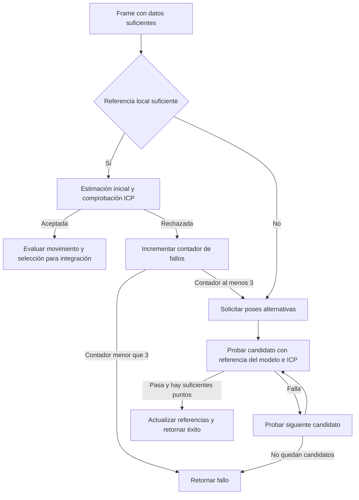

# EXStar: seguimiento y recuperación en el motor

Fecha: 2026-10-15. Quinta tanda de análisis estático, continuación de [Adaptador de algoritmos](EXSTAR_ALGORITHM_DISPATCH.md).

## Objetivo

Seguir las llamadas del adaptador hasta `Sn3DRealtimeScan.dll`, identificar las referencias usadas para recuperar una pose y distinguir aceptación de tracking de selección para integración. La investigación se limita a las rutas conectadas con el flujo anterior; la presencia de código de escaneo dental en la misma DLL no demuestra que EINSTAR lo utilice.

## Identidad y método

- Archivo original: `C:\Shining3d\EXStar\Sn3DRealtimeScan.dll`, 8656376 bytes.
- SHA-256 inicial: `456e4480ded19c74f77445b2aec0d0c2fb61d442c71ed035bb0158538cc043da`.
- REA 6.4.0 y Ghidra 12.1.4, consultas en una sesión persistente.
- Las direcciones son virtuales de la imagen estática. Los offsets de las búsquedas ASCII son offsets de archivo y no se usan directamente como direcciones de funciones.

Se leyeron las tablas PE32+ de exportaciones e importaciones con Python `struct` y se conservaron los resultados en `realtime-selected-exports.json` y `realtime-pe-imports.json`. Son observaciones auxiliares, no registros Evidence de REA. La tabla de importación estándar no cubre importaciones diferidas ni cargas dinámicas.

La búsqueda preliminar ASCII quedó en `realtime-recovery-ascii.json`; sus cadenas son pistas que requieren referencias y descompilación. Entre las dependencias aparecen `Sn3DGeometricTrackFusion.dll` y `Sn3DTextureBasedTrack.dll`. Sus nombres e importaciones no bastan para reconstruir el algoritmo.

## Puntos de entrada elegidos

| Función exportada | Dirección |
|---|---|
| `fusion_and_track_with_speed_limit_has_feature_align_logic` | `0x180257960` |
| `track_pre_frame` | `0x1802b3900` |
| `returnIsEmptyTree` | `0x1802a2180` |
| `track_current_frame` | `0x1802b3800` |

Los puntos iniciales se obtuvieron de exportaciones de esta DLL, no por proximidad a cadenas. Ninguna de esas cuatro exportaciones es un forwarder según la tabla PE inspeccionada.

## Resultado

Se siguió una ruta concreta desde el adaptador hasta la recuperación: seguimiento geométrico local, generación de poses alternativas, validación con ICP y actualización de referencias. **Una pose recuperada puede devolver éxito sin marcar el frame para integración.** Esta distinción responde a una pregunta abierta del informe anterior.

El alcance es la variante `fusion_and_track_with_speed_limit_has_feature_align_logic`. No se comprobó que sea el modo elegido en todas las sesiones EINSTAR, ni se midió su precisión o tasa de recuperación. La búsqueda de candidatos sigue delegada a otra DLL.

## Pasos realizados

1. Identificar las exportaciones que llama el adaptador del informe anterior y abrir la DLL original en REA.
2. Descompilar las entradas y seguir sus llamadas, usando cadenas y referencias como apoyo para identificar métodos internos.
3. Separar las comprobaciones de entrada, el tracking normal y las dos condiciones que llaman a la recuperación.
4. Seguir cada candidato hasta su validación geométrica y las escrituras de estado posteriores.
5. Inspeccionar por separado `track_pre_frame`, el auxiliar de poses y las referencias al contador de fallos.
6. Guardar las evidencias y el snapshot, cerrar REA/Ghidra y verificar los binarios contra el inventario original.

## Cadena de funciones

| Función o identificación por log | Dirección | Papel observado |
|---|---|---|
| Entrada exportada de tracking con recuperación | `0x180257960` | Comprueba el handle y delega |
| `FusionTrack::fusion_and_track_with_speed_limit_has_feature_align_logic` | `0x1804dba40` | Tracking local, selección para integración y activación de recuperación |
| `FusionTrack::feature_align_increment` | `0x1804d4be0` | Prepara nubes, solicita candidatos y los prueba |
| `FusionTrack::is_feature_aline_right` | `0x1804e7160` | Valida candidato y actualiza referencias si pasa las comprobaciones |
| `FusionTrack::for_feature_align` | `0x1804d6410` | Obtiene una referencia bajo la pose candidata y la comprueba mediante ICP |
| Auxiliar de rotación | `0x1804eb7e0` | Aplica dos conversiones `rodrigures` a la rotación recibida |
| Auxiliar de entrega de nube/pose | `0x1804bc9d0` | Intercambia una colección y copia pares nube/pose a destinos recibidos |
| Implementación de `track_pre_frame` | `0x18051cbe0` | Comparación local entre referencia y frame actual |
| Implementación de `returnIsEmptyTree` | `0x1804eb7c0` | Compara con cero el resultado de un método virtual |

Los nombres obtenidos de logs no implican que se hayan recuperado sus declaraciones originales. El pseudocódigo muestra prototipos incompletos en algunos llamadores: por ejemplo, la validación recibe más parámetros en su cuerpo que los mostrados en el sitio de llamada. Por eso no se atribuyen valores exactos a todos sus umbrales.

El diagrama omite inicialización, logs y ramas de velocidad. El umbral de tres pertenece a esta función y versión; no es una especificación general de EXStar ni una decisión para TrueDepth.

## Tracking local y activación de recuperación

En `0x1804dba40` se comprueba la cantidad de puntos válidos del frame contra un umbral del objeto. También aparece una comprobación del resultado de `plane_detect` contra `0.8`, acompañada de un log de rechazo por predominio de plano. No se inspeccionó el cálculo de esa magnitud: no se convierte en una regla universal de «80 % de superficie plana» ni en un umbral trasladable al iPhone.

La referencia local está en el offset `0x280` del objeto. Si no alcanza el mínimo de puntos válidos, la función pone `isNeed=false` y llama directamente a `feature_align_increment`.

Con referencia suficiente, copia referencia y frame a estructuras de trabajo y llama a:

1. `ParticleTrack::partical_track_pyramid`, como estimación inicial.
2. `IcpBaseOnCam::realTime_icp_and_check`, para comprobar y refinar el registro.
3. `get_residual`, cuando el retorno de ICP es cero.

Esta rama acepta el resultado si ICP devuelve cero y el residual no supera el doble del residual almacenado en el offset `0x6c`. Entonces actualiza ese valor y pone a cero `DAT_180817bd8`.

Si falla ICP o la comparación del residual, incrementa ese contador. Con valor menor que tres devuelve fallo; con valor al menos tres llama a `feature_align_increment`. Antes de esa decisión pone `isNeed=false`.

El contador es una ubicación global, no un miembro identificado por sesión. `xrefs` devuelve tres referencias analizadas dentro de esta ruta, correspondientes a la puesta a cero, incremento y comparación. Esto no demuestra ausencia de accesos indirectos ni permite inferir aislamiento entre escaneos concurrentes.

## Cómo obtiene y comprueba poses alternativas

### Generación de candidatos

`feature_align_increment` construye una nube con puntos cuya coordenada Z y valor absoluto de la componente Z de la normal superan `1e-6`. Entrega esa nube a `BoardsRegistration::set_obj_cloud`.

Cuando el flag en `0xabc` está activo, copia la nube guardada en `0xb40`, aplica `squeeze(true)` y llama a `set_ref_cloud`. Si esta preparación funciona, limpia el flag. **Todavía no se identificó quién construye o renueva esa nube de referencia.**

Luego llama a `BoardsRegistration::compute_registration`, que devuelve una colección de matrices rígidas. Prueba cada una con `is_feature_aline_right` y termina al aceptar una. Un fallo de preparación, de registro o la ausencia de un candidato aceptable termina en falso.

Estas tres funciones de `BoardsRegistration` se importan de `CommonFunc.dll`. El nombre de la clase y las cadenas de log no demuestran qué descriptores, estrategia de correspondencias o algoritmo robusto usa internamente. No se atribuyen RANSAC, FPFH ni otros métodos sin analizar esa implementación.

### Validación y refinamiento

`is_feature_aline_right` llama a `for_feature_align`. Esta última:

1. Exige suficientes puntos válidos en el frame actual.
2. Prepara una imagen de puntos vacía y llama al método virtual del slot `0x40` del objeto almacenado en `0x2458`, usando la pose candidata.
3. Convierte el resultado a coordenadas originales y exige suficientes puntos válidos en esa referencia.
4. Cambia temporalmente parámetros de ICP, ejecuta `realTime_icp_and_check` entre referencia y frame, y restaura los parámetros.
5. Si ICP devuelve cero, compone la pose de salida; si falla, devuelve falso y deja la matriz de salida en identidad.

**Inferencia:** el slot `0x40` obtiene una vista del modelo bajo una pose, compatible con un raycast. La misma llamada aparece en la ruta normal junto a un log que nombra `Raycast _mapPre`. Su implementación virtual concreta aún no está resuelta; no se afirma qué representación del volumen usa.

Después del refinamiento, `is_feature_aline_right` vuelve a obtener una referencia con la pose resultante y comprueba su número de puntos. Solo si pasa esta última condición escribe la referencia en `0x280`, agrega la pose a una colección, copia el frame a `0x550`, llama al auxiliar `0x1804bc9d0`, pone a cero el campo `0x1958` y devuelve verdadero.

El auxiliar copia pares nube/pose a destinos recibidos y gestiona una colección bajo mutex. Los argumentos adicionales no están completos en el llamador descompilado: **no se demuestra que este auxiliar actualice la nube `0xb40` usada para generar candidatos**. Tampoco se ha demostrado que toda la validación sea una transacción sin efectos intermedios.

## Tracking aceptado e integración son distintos

La ruta normal contiene estas decisiones separadas:

- Si `isNeed` llega en falso, un método virtual del slot `0x38` puede producir un valor que permita activarlo. Su significado exacto no está resuelto.
- Con tracking aceptado pero movimiento menor que ambos umbrales de rotación y traslación, pone `isNeed=false` y devuelve éxito.
- En la rama que continúa a fusión, la llamada virtual del slot `0x08` está condicionada a `isNeed` verdadero. Su cuerpo sigue pendiente.
- Hay ramas de velocidad que impiden continuar aunque ICP haya funcionado, y otras que permiten continuar según el estado recibido. No se deduce una política única a partir del mensaje de log.
- Las dos entradas a recuperación ponen `isNeed=false` y devuelven el resultado del fallback sin volver a activarlo en el llamador. Así, recuperar una pose no implica seleccionar ese frame para integración.

Esto respalda un contrato propio con campos separados: `trackingAccepted`, `integrationSelected`, `integrationCompleted` y `rejectionReason`. Son nombres propuestos para TrueDepth, no campos recuperados de EXStar. La selección tampoco prueba que una operación de integración haya terminado correctamente.

## Qué hace la comprobación previa

`track_pre_frame` conserva una referencia local. Si esta no contiene puntos válidos, copia el frame actual y devuelve falso. Si ya hay referencia, ejecuta `realTimeIcp`: con retorno cero vacía la referencia y devuelve verdadero; ante fallo reemplaza la referencia por el frame actual y devuelve falso.

Esta función por sí sola no realiza la búsqueda de candidatos descrita arriba. Queda pendiente el origen del flag que la activa desde el adaptador y su relación completa con pausa/reanudación.

`returnIsEmptyTree` compara con cero el resultado del slot virtual `0x30`. La inicialización de la ruta principal usa esa misma comprobación, pero todavía no se conoce el tipo concreto del árbol ni el método virtual al que corresponde.

Se conservó además la descompilación de `track_frame_and_featureAlign_after_trackFailed` en `0x18051bb70`, localizada mediante referencias a su cadena de log. Su nombre y llamadas aportan contexto, pero no se reconstruyó su cadena de invocadores desde el modo EINSTAR; las conclusiones principales se apoyan en la ruta conectada con el adaptador anterior.

## Aplicación al proyecto y próximos pasos

El roadmap completo se mantiene. Para el motor propio, esta tanda sustenta separar seguimiento local, recuperación y admisión de nuevos datos. La implementación deberá conservar el modelo aceptado, producir candidatos y comprobarlos antes de retomar integración. Los umbrales se deberán medir con capturas TrueDepth; no se copiarán los valores observados como garantía de calidad.

Pruebas propuestas para cuando exista el prototipo: retirar la cámara y volver a una zona conocida; ocluirla; recorrer una superficie pobre en geometría; presentar objetos simétricos; repetir pausa/reanudación; y comprobar que una pose incorrecta no contamina el modelo. Habrá que medir recuperación correcta, falsos positivos, latencia y error geométrico. Estas pruebas aún no se ejecutaron.

El siguiente análisis acotado es `CommonFunc.dll`, empezando por `BoardsRegistration::set_ref_cloud`, `set_obj_cloud` y `compute_registration`. También queda pendiente seguir el productor de `0xb40`, resolver los slots virtuales y los argumentos omitidos mediante instrucciones de máquina. Después interesa `Sn3DGeometricTrackFusion.dll`, donde se importa la comprobación ICP.

También siguen pendientes la confirmación dinámica del modo EINSTAR, el flujo completo de pausa/reanudación, la ruta RGB y la interpretación de `0x2a30000b`. No se ejecutó EXStar en esta tanda ni se añadió ninguna DLL propietaria al proyecto.

## Evidencia y cierre

Se conservaron 18 registros Evidence de REA, incluidos 12 resultados de descompilación. El índice local `realtime-evidence-index.json` registra sus identificadores y hashes de archivo. Los JSON completos y binarios permanecen fuera de Git.

| Archivo local | Evidence ID |
|---|---|
| `realtime-feature-track-core-pseudo.json` | `ev_f0658dc7e864c253b204188b435478fad177e5d5127e22f8f6cf8c296baafa1e` |
| `realtime-feature-fallback-pseudo.json` | `ev_55b695e7dd90e194c6bcad5d89db6b645611cb8c60efc1314e5785e12f152efb` |
| `realtime-validation-pseudo.json` | `ev_61298abe02e83dd4d8529c89583ffd24b88e380e0ca8281bc5f24c314920a864` |
| `realtime-geometric-relocal-pseudo-v2.json` | `ev_f068de279dc834bf6aa552b326d82e1053f6978e76e04506b42276190d9b9067` |
| `realtime-reference-update-pseudo.json` | `ev_dc667ee2db0e1cb66eaa8422005d0a5708159b23b0e516fa9c4e2003df72220c` |
| `realtime-track-pre-core-pseudo.json` | `ev_a699996692f9a94d398e6200d88cec9f7436422adb55406c2303a3a27a9e8ade` |
| `realtime-empty-tree-core-pseudo.json` | `ev_162e8e87f0e47e4ca31cc7c5908e57c8393090ea8cb2c6819c5e88e9fecf6c56` |
| `realtime-failure-counter-xrefs.json` | `ev_2a78971d27b1297c4158550f8514cc6b9f9dbf6362bdbcc7c22abc3dcaed840f` |
| `realtime-pose-helper-pseudo.json` | `ev_2ff3ac29f0a372de3b81657109e197e80e6d8b02ec50a18deaea76a03a0fc6af` |

Una consulta usó por error `address` en lugar de `procedure` y fue rechazada por el esquema antes de analizar. Se conservó ese error y se repitió correctamente con el sufijo `v2`; el error no cuenta como evidencia exitosa.

La preparación y primera descompilación duraron 338990,63 ms, aproximadamente 5 minutos y 39 segundos. Las siguientes consultas reutilizaron la sesión. El log de autoanálisis registró un error al crear datos en `0x1805f9be8`; el análisis continuó y devolvió las funciones solicitadas. Los resultados incluyen avisos de bloques inalcanzables, tipos inferidos y llamadas terminales asumidas por Ghidra. No se consideran equivalentes al código fuente ni prueba de cobertura completa.

El snapshot `realtime-session-snapshot.json` ocupa 649365 bytes y contiene 18 evidencias, con cero entradas primitivas/workflow reutilizables. Conserva evidencia, no una base persistente que evite importar de nuevo. El cierre explícito del binario y del helper terminó correctamente.

La comprobación final comparó los 280 ejecutables/DLL del inventario original: ninguno cambió. El SHA-256 de la DLL analizada coincide con el inicial. El registro local es `realtime-integrity-check.json`; al terminar no quedaron procesos propios de REA/Ghidra de esta sesión.

Continuación: [Generación de candidatos](EXSTAR_REGISTRATION_CANDIDATES.md) sigue `BoardsRegistration` dentro de `CommonFunc.dll` y documenta las características geométricas, las correspondencias, Hough y el filtro por inliers. Las preguntas que aquí figuran como pendientes describen el cierre de la quinta tanda.
