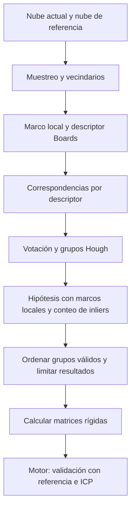

# EXStar: generación de candidatos de alineación

Fecha: 2026-10-16. Sexta tanda de REA/Ghidra, continuación de [Motor de recuperación](EXSTAR_RECOVERY_ENGINE.md).

## Alcance y preguntas

Seguir en `CommonFunc.dll` las tres funciones de `BoardsRegistration` importadas por la ruta de recuperación anterior: `set_obj_cloud`, `set_ref_cloud` y la variante de `compute_registration` que recibe un vector de poses, un booleano y un puntero a entero.

Preguntas de esta tanda:

1. ¿Cómo prepara las dos nubes y sus características?
2. ¿Cómo encuentra correspondencias y genera varias poses?
3. ¿Qué condiciones rechazan candidatos y cómo limita los resultados?
4. ¿Qué parte queda pendiente antes de poder especificar nuestro motor propio?

## Identidad y método

- Original: `C:\Shining3d\EXStar\CommonFunc.dll`, 5342712 bytes.
- SHA-256 inicial: `9427a6fedbd3f2474623be32687eb50988a2b587f662588422196669fa38c53c`.
- REA 6.4.0, Ghidra 12.1.4 y JDK 21; análisis estático de solo lectura.
- Direcciones virtuales de la imagen estática, no direcciones observadas en ejecución.

Las tablas PE se leyeron con Python `struct`. Los registros auxiliares locales son `commonfunc-boards-exports.json` y `commonfunc-pe-directory.json`; no son Evidence de REA. El inventario contiene 53 exportaciones de `BoardsRegistration`, entre 1487 exportaciones totales. Las importaciones estándar no incluyen cargas dinámicas ni importaciones diferidas.

La primera descompilación de `compute_registration` quedó guardada antes de interrumpirse la sesión. Al retomar se reutilizó ese resultado y se abrió una sesión nueva para las consultas restantes; el proyecto temporal de Ghidra no seguía activo.

## Puntos iniciales

| Exportación | Dirección |
|---|---|
| `set_obj_cloud` | `0x180279520` |
| `set_ref_cloud` | `0x18027b490` |
| `compute_registration(vector<RigidMatrix>&, bool, int*)` | `0x1802730a0` |
| `find_correspondence` | `0x180276260` |
| `Hough3DGrouping::registration_with_mutil_result`, sin entero de salida adicional | `0x180293510` |

## Resultado

La ruta investigada prepara puntos de muestra, marcos de referencia locales y un descriptor escalar `Boards`; busca correspondencias por proximidad de ese descriptor; agrupa votos mediante Hough; filtra cada grupo con `RansacRegistration`; ordena los grupos válidos por correspondencias conservadas y calcula las matrices que entrega al motor. La comprobación ICP del informe anterior sucede después.

**El nombre `BoardsRegistration` ya está conectado con comportamiento descompilado, no solo con símbolos.** Eso no demuestra equivalencia con un descriptor publicado llamado BOARD, ni que todas las rutas de EXStar utilicen este algoritmo. Tampoco demuestra rendimiento o precisión con TrueDepth.

## Pasos y continuidad de evidencia

1. Leer las tablas PE y comparar los nombres decorados completos: las tres importaciones de `Sn3DRealtimeScan.dll` coinciden exactamente con las exportaciones elegidas de `CommonFunc.dll`.
2. Reutilizar la descompilación guardada de `compute_registration`. El llamador anterior pasa `false` al booleano; en esta función eso selecciona `Hough3DGrouping::registration_with_mutil_result`. La rama alternativa no es el foco de esta tanda.
3. Seguir `set_obj_cloud` y `set_ref_cloud` hasta las variantes que reciben vectores de nubes, y de allí al muestreo y al cálculo de características.
4. Descompilar búsqueda de correspondencias, agrupación Hough, selección de grupos y cálculo de matrices.
5. Seguir dos tareas indirectas mediante referencias, lectura de tablas virtuales y descompilación de sus destinos. Esto permite ver el cálculo de características por punto y el filtro de grupos, que no aparecen completos en los métodos principales.
6. Consultar el constructor y los accesores para distinguir valores iniciales de parámetros configurables.
7. Guardar evidencias, cerrar la sesión y verificar la integridad original.

## Preparación de las nubes

`set_obj_cloud` y `set_ref_cloud` envuelven la nube en un vector de un elemento y delegan respectivamente a `set_obj_clouds` (`0x180279710`) y `set_ref_clouds` (`0x18027b680`).

Ambas rutas llaman a `find_keyPoints` y a `compute_feature`. Utilizan radios de muestreo distintos: objeto en el offset `0x00` y referencia en `0x04`. La referencia rechaza con retorno `2` un puntero de nube nulo o una nube cuyo indicador en `0x30` está desactivado. No se asigna un nombre de enum a ese código.

La selección de puntos en `0x1802781b0` reúne coordenadas y normales de las nubes, mantiene su procedencia y contempla dos ramas: `UniformSampling::sampling` y una organización en grilla con comprobaciones de normales. La segunda puede conservar otro punto con normal opuesta dentro de un grupo. No se equipara el término `keyPoints` con un detector de esquinas concreto.

El objeto y la referencia guardan estructuras separadas:

| Contenido | Objeto | Referencia |
|---|---|---|
| Nube de puntos seleccionados | `0x128` | `0x30` |
| Vector de marcos locales | `0x1d8` | `0xe0` |
| Vector de descriptores `Boards` | `0x1f0` | `0xf8` |

Estos offsets describen esta clase y versión, no un formato público de archivos. `set_obj_clouds` falla si no queda ningún descriptor; `set_ref_clouds` falla si no queda ningún marco local. Ambas rutas devuelven cero cuando completan su preparación válida.

## Característica geométrica observada

`BoardsRegistration::compute_feature` (`0x1802726e0`) llama a `BoardsFeature::compute_features` (`0x18026a3b0`). Esta última prepara una `CloudGrid` y procesa los puntos mediante una tarea paralela.

Se siguió la tabla virtual `0x1803fc4c8`, referenciada por esa función: su slot `0x10` apunta a `0x180269ca0`, que delega al trabajador `0x1802698c0`. Allí se observa una búsqueda de vecinos por radio, un filtro opcional de normales opuestas y la llamada a `BoardsFeature::compute_feature` (`0x180269de0`). Las tablas y sus valores crudos se conservaron como evidencia auxiliar, vinculada al hash de la DLL.

Por punto, el cálculo produce un marco de nueve valores `double` y un descriptor de un `float`. El cuerpo inspeccionado:

- Reúne diferencias de coordenadas dentro de un radio y exige al menos diez vecinos de ese subconjunto.
- Obtiene un eje mediante un auxiliar matemático y orienta su signo usando la normal del punto.
- Busca una proyección máxima de vecinos sobre ese eje, priorizando un subconjunto exterior; si no hay vecinos allí, usa el conjunto disponible.
- Guarda ese máximo como descriptor y construye los otros ejes del marco.
- Marca los resultados como `NaN` si faltan vecinos o la construcción del marco resulta degenerada. El llamador descarta resultados con los valores comprobados en `NaN`.

El auxiliar que estima el primer eje no se descompiló. No se afirma una formulación exacta de PCA/SVD ni equivalencia con una implementación abierta. La existencia de código SHOT en otras exportaciones de la DLL no lo convierte en el descriptor de esta ruta.

## Búsqueda de correspondencias

`find_correspondence` (`0x180276260`) prepara pares descriptor/índice y los ordena por valor escalar. Para cada descriptor del objeto busca una ventana de valores de referencia. La amplitud combina una escala derivada del rango entre descriptores y una componente relativa al valor actual, gobernadas por campos de la clase.

Cada correspondencia conserva dos índices y la diferencia absoluta entre descriptores. Se observa un paso de submuestreo calculado a partir del número de coincidencias y el parámetro de cantidad máxima. **No se interpreta como un límite duro exacto:** la selección se realiza por intervalos y redondeos.

Esto explica por qué una semejanza local no equivale a una pose aceptable: varias regiones pueden producir valores parecidos. La coherencia espacial se evalúa en las etapas siguientes. No se observó aquí una regla de vecino único ni una prueba de cociente de distancias típica de otros descriptores.

## De correspondencias a poses candidatas

### Agrupación Hough

La variante conectada con el motor rechaza menos de tres correspondencias. Prepara datos usando el centro de la nube objeto y sus marcos locales. La configuración local creada por `compute_registration` activa los flags utilizados para pesos, interpolación y marcos locales; la agrupación entra a `hough_voting_interplate` (`0x18028e4e0`).

Esa función acumula votos en una estructura `HoughSpace3DFast2`, con pesos basados en la distancia de descriptor cuando corresponde, busca máximos y reúne índices de correspondencias por celdas seleccionadas. Existe una selección adicional cuando aparecen más de veinte máximos; no se presenta como «exactamente veinte candidatos» porque selecciona por un umbral de voto y puede haber empates. No se siguió cada tarea interna de construcción de votos ni el cuerpo de extracción de máximos.

### Filtro de grupos con marcos locales

La tarea creada en `0x18027f1c0` referencia la tabla virtual `0x1803fe358`. Su slot `0x10` lleva a `0x1802880b0`, que llama al trabajador `0x180285d60`. Este reconstruye las correspondencias de cada grupo y llama a `RansacRegistration::registration_with_lrf` cuando el flag de marcos locales está activo, como ocurre en la configuración observada. También existe una rama sin marcos locales, no investigada aquí.

`registration_with_lrf` (`0x180299970`) recorre correspondencias en orden, con un límite de iteraciones. Cada correspondencia y sus dos marcos locales producen una hipótesis de transformación; se cuenta cuántas correspondencias son compatibles y se conserva la mejor. Exige más de dos inliers para devolver éxito y extrae sus correspondencias compatibles.

**Precisión sobre el nombre:** aunque pertenece a la clase `RansacRegistration`, este cuerpo no muestra selección aleatoria de muestras; muestra un recorrido secuencial de hipótesis apoyadas en marcos locales. No se atribuye aleatoriedad por el nombre.

`get_inliner_count` (`0x180298ce0`) y `get_inliner_correspondences` (`0x180298b50`) comparan distancia geométrica cuadrática después de transformar el punto, contra el cuadrado de un umbral. El conteo usa evaluación por etapas con salidas anticipadas según la mejor cuenta anterior. La selección final conserva correspondencias cuya distancia cuadrática es estrictamente menor que el umbral cuadrático. No se convierten estos parámetros a milímetros sin verificar las unidades y la configuración efectiva.

### Orden y límite de resultados

La función Hough conserva los grupos cuyo filtro devolvió cero y los ordena por cantidad de correspondencias conservadas, de mayor a menor. Descarta los que quedan por debajo de una fracción del soporte del mejor grupo. En la configuración local de esta ruta esa fracción se inicializa a `0.8`; no es «80 % de confianza» ni mide cobertura del escaneo.

Para cada grupo que continúa, obtiene sus pares de coordenadas y llama a `compute_rigid_matrix`. Agrega la matriz solo si esa llamada devuelve cero. Se detiene al alcanzar el máximo solicitado. Si la lista final queda vacía, devuelve fallo.

El constructor de `BoardsRegistration` pone el máximo de resultados en `3`; el getter y setter confirman que el campo `0x2c` es configurable. **No se comprobó qué valor deja configurado EXStar al crear la instancia usada por EINSTAR.** El constructor también contiene valores negativos iniciales en varios radios y límites: no son parámetros listos para copiar a nuestro sensor.

## Qué aporta al proyecto

La evidencia respalda dividir la recuperación propia en generación de hipótesis y validación geométrica posterior. Las propuestas para TrueDepth son:

- Conservar varias hipótesis plausibles y contrastarlas con el modelo antes de reanudar integración.
- Registrar métricas separadas para correspondencias iniciales, soporte geométrico, error de ICP y resultado final.
- Comparar radios de muestreo y vecindarios con capturas reales; el ruido y la densidad de TrueDepth deben gobernar esos parámetros.
- Probar superficies lisas, simetrías, solapamiento pequeño y normales inestables. Un descriptor parecido o muchos votos no garantizan una recuperación correcta.

Estas son decisiones de diseño propuestas, no una implementación terminada ni código propietario incorporado. El roadmap aprobado permanece completo. La selección y evaluación de una biblioteca abierta requiere una comparación aparte; este informe no demuestra que una alternativa sea equivalente a EXStar.

## Preguntas resueltas y pendientes

| Pregunta | Estado |
|---|---|
| Preparación de nubes y características | Resuelta a nivel de cadena de llamadas, muestreo y salidas; auxiliares matemáticos parcialmente pendientes |
| Correspondencias y generación de poses | Resuelta para la rama Hough conectada con el llamador anterior |
| Filtros y cantidad de resultados | Identificados: datos suficientes, inliers, soporte relativo, matriz válida y máximo configurable |
| Parámetros efectivos de EINSTAR | Pendientes: el constructor no prueba la configuración posterior |
| Precisión, rendimiento y recuperación con TrueDepth | Pendientes de implementación y pruebas físicas |

Sigue pendiente el productor de la nube `0xb40` en `Sn3DRealtimeScan.dll`, la política de actualización de referencias, los slots virtuales del modelo y el ciclo completo de pausa/reanudación. Tampoco se investigó la rama alternativa de `compute_registration`, la ruta RGB ni toda la matemática interna de Hough y del ajuste rígido.

El próximo paso acotado es seguir la comprobación `IcpBaseOnCam::realTime_icp_and_check` en `Sn3DGeometricTrackFusion.dll`: criterios de aceptación, error residual y condiciones de rechazo. Permitirá completar el contraste entre «candidato plausible» y «pose suficientemente válida para continuar».

## Evidencia y cierre

Se conservaron 29 registros Evidence, incluidos 26 resultados de descompilación, en el índice local `commonfunc-evidence-index.json`. Uno corresponde a la sesión anterior y 28 a la sesión retomada; el primer resultado se reutilizó desde su archivo guardado.

| Archivo local | Evidence ID |
|---|---|
| `commonfunc-compute-registration-pseudo.json` | `ev_eb608c74bb34a3db92cdb0586008e7cd68b6914f5a131d2599fc44f474feb4eb` |
| `commonfunc-set-objs-pseudo.json` | `ev_5e84344a2e9824a36decda98756653dde025212c7f95d16806b57eff04f0ed50` |
| `commonfunc-set-refs-pseudo.json` | `ev_e6119db0d6aac14ffd90486bee470c07f9ed0b1066776e51eb8da52e8ee50988` |
| `commonfunc-features-pseudo.json` | `ev_e5c4a199c36a6674ff7438b9f453d87c09a3fa465b954c1f2b961b94abd9e500` |
| `commonfunc-board-feature-pseudo.json` | `ev_7b69b4d8705a5e54745577e9490db09ccf8f3d7cb181a99c29017a6dc7a87128` |
| `commonfunc-correspondence-pseudo.json` | `ev_ee711e56d9d9d5d86873160be98b71d5dba918d9df365cf022be27994d2c6882` |
| `commonfunc-hough-multiple-pseudo.json` | `ev_8e428b03a5a10f21971c0c16cef6b9ace079dd34390f036082603000d8dde284` |
| `commonfunc-cluster-filter-pseudo.json` | `ev_c92b9e000af711455e62edd0884638fa4af962b82718c1f688dbce8ab0a2ced1` |
| `commonfunc-ransac-lrf-pseudo.json` | `ev_138a67f1e5bd0fa74147c12d0863267bf934a109ad340b783c5da562f5d94c1a` |
| `commonfunc-inlier-selection-pseudo.json` | `ev_901793f03118fb4a3c5947114e24e4fcd1785bc3ef29140bbf8de4affe337840` |
| `commonfunc-boards-constructor-pseudo.json` | `ev_a0b0afccafc223fe60b588a97fc27aab43eba1b45bf8da8224f631b333bb67d1` |

El snapshot `commonfunc-session-snapshot.json` conserva los 28 registros de la sesión retomada y ocupa 711841 bytes. Informa cero entradas primitivas/workflow reutilizables. La primera consulta de esa sesión, incluyendo preparación de Ghidra, tardó 267850,66 ms, aproximadamente 4 minutos y 28 segundos. El primer análisis anterior había tardado 228481,69 ms. Son tiempos de análisis estático, no rendimiento del algoritmo.

Ghidra registró un error al crear datos en `0x1803d9058` y continuó. Se conservan las limitaciones de tipos inferidos, argumentos omitidos en algunos llamadores, despacho indirecto y supuestos sobre llamadas terminales. El pseudocódigo no es código fuente original ni demuestra ejecución. El cierre explícito del binario y del helper terminó correctamente. Las evidencias completas y los binarios permanecen fuera de Git.

La comprobación final de los 280 ejecutables/DLL contra el inventario original no encontró cambios. El hash final de `CommonFunc.dll` coincide con el inicial; el resultado está en `commonfunc-integrity-check.json`. Al cierre no quedaron procesos propios de REA/Ghidra de esta sesión.
