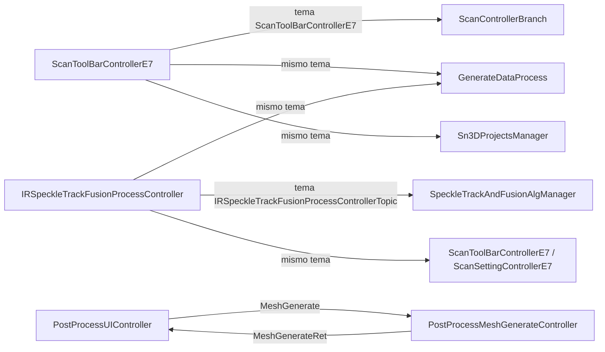

# Primera investigación de EXStar con REA

Fecha: 2026-10-14. Investigación estática sobre EXStar 1.2.2.0 instalado localmente. Complementa el roadmap aprobado; no elimina requisitos ni cambia sus fases.

## Objetivo y alcance

Entender la separación de módulos, comandos y estados de EXStar para diseñar nuestro escáner iPhone + Windows. Las prioridades son pausa/reanudación, recuperación del seguimiento, proyectos, alineación y posprocesamiento. El análisis se realiza sobre la instalación original, no sobre la copia UI Lab con el chequeo de GPU modificado.

Este primer pase establece el entorno reproducible, verifica una ruta de arranque mediante descompilación y comienza la investigación del módulo de seguimiento/fusión. No representa una reconstrucción completa de EXStar. Las conclusiones describen comportamiento y arquitectura; el repositorio no incluye sus DLL, configuraciones completas ni pseudocódigo descompilado.

## Paso 1. Preservar y seleccionar la evidencia

- Instalación analizada: `C:\Shining3d\EXStar`.
- Inventario previo: `.local/exstar-baseline.json`, con hashes de 280 binarios raíz y 169 declaraciones de temas de comunicación.
- Copia de exploración visual: `C:\Shining3d\EXStar-UI-Lab`. Se mantiene separada del objetivo de REA.
- Primer objetivo: `PrestartCheck.dll`, función `0x180003330`, previamente identificada en la inspección del arranque.
- Segundo objetivo: `ScanAlignFusionProcess.dll`, seleccionado por los controladores declarados en `ScanService.xml`.

Los nombres de módulos, controladores y cadenas son pistas. Una asociación declarada en XML no demuestra que una ruta se haya ejecutado ni identifica por sí sola un algoritmo.

## Paso 2. Preparar REA y Ghidra localmente

| Componente | Versión utilizada | Ubicación |
|---|---|---|
| Node.js / npm | 24.15.0 / 11.12.1 | Instalación existente |
| JDK completo | 21.0.6 | `C:\Program Files\Java\jdk-21` |
| REA npm | `rea-agents@6.4.0` | `.local/tools/rea-runtime` |
| Ghidra | 12.1.4 PUBLIC | `.local/tools/ghidra_12.1.4_PUBLIC` |
| Documentación/skill de REA | commit `cbc0e97c29b8dcb3d6ff96eb3af9e0f519a22345` | `.local/tools/rea-source` |

Se utilizó la skill `reverse-engineer-anything` del repositorio REA: selección de evidencia, preguntas acotadas, separación entre hechos e inferencias y conservación de los identificadores de resultados. REA se ejecuta por su CLI oficial; no se registró un servidor MCP ni se modificó la configuración global de Codex.

Instalación local del paquete:

```powershell
npm.cmd install --prefix .local/tools/rea-runtime --no-audit --no-fund --ignore-scripts rea-agents@6.4.0
```

Ghidra se descargó de la [publicación oficial 12.1.4](https://github.com/NationalSecurityAgency/ghidra/releases/tag/Ghidra_12.1.4_build). Archivo: `ghidra_12.1.4_PUBLIC_20260921.zip`; tamaño: 569649598 bytes; SHA-256 verificado antes de extraer:

```text
ddac49f903da9d5bac833e5cc79395098b9c33cfd3279be5f31bd00387d2d4db
```

Descargar ese archivo de la publicación, comprobarlo con `Get-FileHash -Algorithm SHA256` y extraerlo en `.local/tools`, conservando el nombre de la carpeta. Se necesita un JDK completo, incluido `javac`, no solo un JRE.

El ejecutor [Invoke-Rea.ps1](../../tools/Invoke-Rea.ps1) configura únicamente el entorno del proceso y lo restaura al terminar. Selecciona Ghidra, el JDK y, por defecto, un heap de Java de 1 GB y un límite de arranque de 330000 ms. Acepta `-Heap` y `-StartupTimeoutMs` para objetivos mayores. El heap no incluye toda la memoria de Ghidra/Node ni garantiza que cualquier DLL quepa en RAM. Ejecutar consultas nativas de forma secuencial en la PC de 8 GB.

## Paso 3. Verificar el proveedor

```powershell
& ./tools/Invoke-Rea.ps1 -ReaArguments @('--version')
& ./tools/Invoke-Rea.ps1 -ReaArguments @('doctor', '--provider', 'ghidra', '--client', 'codex', '--format', 'json')
```

La versión devolvió `6.4.0`. El diagnóstico verificó Ghidra, Java, el descompilador nativo y los controles de sesión de Windows. El diagnóstico completo devolvió código 1 por falta de registro MCP/skill en Codex; esto no impidió el análisis por CLI. No confundir ese estado con un fallo del proveedor Ghidra.

Evidencia local: `.local/rea-evidence/doctor.json`.

## Paso 4. Confirmar la ruta del aviso de NVIDIA

```powershell
New-Item -ItemType Directory -Force .local/rea-evidence | Out-Null
& ./tools/Invoke-Rea.ps1 -ReaArguments @(
  'decompile', 'C:\Shining3d\EXStar\PrestartCheck.dll', '0x180003330',
  '--provider', 'ghidra', '--format', 'json'
) > .local/rea-evidence/prestart-cuda.json
```

Resultado: consulta exitosa de `procedure_pseudo_code`. REA/Ghidra produjo pseudocódigo de la función solicitada.

**Observado en el resultado estático:**

1. La función lee `errorCode` de un mapa Qt y lo convierte en entero.
2. Con valor cero toma una ruta que actualiza estado y comprueba otros elementos pendientes.
3. Con valor distinto de cero prepara un diálogo con referencias a `NVIDIA GTX 1050`, `NVIDIA` y `OK`.
4. Después del diálogo publica un comando `quitApp` mediante el gestor de procesos.

**Conclusión:** se confirma la ruta de coordinación del error de arranque y salida de la aplicación. Esto explica el bloqueo visual observado, pero no demuestra que los algoritmos de escaneo puedan funcionar sin CUDA. Tampoco convierte la copia UI Lab en un escáner funcional.

| Ancla | Valor |
|---|---|
| Binario | `PrestartCheck.dll`, 433656 bytes |
| SHA-256 original | `4c4ebba497a63605483e0c80ea1019c2f62f19ebecbc0c377bd110f06d953872` |
| Dirección virtual | `0x180003330` |
| Evidence ID | `ev_fd3063debc5d434c5c8ac9e3036738f919a0fcc0637916c701fb82bc10c779e0` |
| Perfil de análisis | `90e13888e18b7d587414bb259f5e3dc44a7c9293bdf290ad8c459be524747d9f` |
| Evidencia completa local | `.local/rea-evidence/prestart-cuda.json` |

No se asigna significado a constantes internas ni a funciones auxiliares todavía no trazadas. El pseudocódigo es una interpretación de Ghidra, no el código fuente original.

## Paso 5. Mapear responsabilidades antes de seguir referencias

Se extrajeron únicamente `name` y `libpath` de elementos `controllerobject` en `App_EA.xml` y `ScanService.xml`. Evidencia local: `.local/rea-evidence/controller-map.json`. Las configuraciones completas permanecen locales.

La extracción es reproducible con la versión 2 de `tools/inventory_exstar.py`, que incorpora `controllers` al JSON sin exportar otros ajustes. Se ejecutó sobre la instalación real y registró 793 declaraciones de controladores. La comparación con la línea base verificó que los 280 binarios y ambos XML conservan sus hashes; no hubo altas, bajas ni cambios en ese alcance. Resultado: `.local/rea-evidence/integrity-check.json`.

```powershell
python tools/inventory_exstar.py --source C:\Shining3d\EXStar --output .local/rea-evidence/exstar-inventory-v2.json
```

Hashes de las configuraciones utilizadas:

- `App_EA.xml`: `6699cc46ed35f2ed057716f85684033a890c0178b17526419021d29b775812f9`.
- `ScanService.xml`: `875cd8945e8cf39732fa5b6b60943a6e186a25bef159749c022fc60cea516693`.

| Responsabilidad sugerida | Controladores declarados | Biblioteca declarada |
|---|---|---|
| Arranque | `PrestartCheckController` | `PrestartCheck` |
| Página, ajustes y barra de escaneo | `ScanPageControllerE7`, `ScanSettingControllerE7`, `ScanToolBarControllerE7` | `ScanPage_E7` |
| Control de adquisición | `SequenceScanController`, `Sn3DIRSpeckleScanController`, `Sn3DWLSpeckleScanController` | `Sn3DScanController` |
| Reconstrucción | `SequenceRebuildController`, controladores IR/WL | `RebuildProcess` |
| Seguimiento y fusión | `SequenceTrackFusionProcessController`, `IRSpeckleTrackFusionProcessController`, `WLSpeckleTrackFusionProcessController` | `ScanAlignFusionProcess` |
| Adaptadores de algoritmos | `SpeckleTrackAndFusionAlgManager`, `SequenceTrackFusionAlgManager` | `Sn3DAlgorithmWrapper` |
| Generación de datos | `GenerateDataProcess` | `GenerateDataProcess` |
| Edición de escaneo | `Sn3DHandheldScanEditProcessController` | `ScanEditProcess` |
| Alineación manual | `Sn3DManualAlign` | `Sn3DManualAlign.dll` |
| Generación/optimización de malla | `PostProcessMeshGenerateController`, `PostProcessMeshOptController` | `PostProcess.dll` |
| Interfaz de posprocesamiento | `PostProcessUIController` | `PostProcessUI` |

**Inferencia útil para nuestro producto:** mantener separados la UI, el control de sesiones y el motor geométrico. Esa división permite ensayar seguimiento y fusión con capturas guardadas sin depender de la interfaz ni del iPhone conectado. No implica reutilizar los binarios de EXStar.

Rutas seleccionadas de publicadores/suscriptores declarados en los dos XML (diagrama parcial de configuración, no una traza de ejecución):



El tema de seguimiento IR tiene además suscriptores relacionados con proyectos, envío de datos al cliente y otros controladores. Las flechas no implican llamadas directas, orden temporal ni un protocolo de transporte concreto. El XML no contiene aquí la condición algorítmica de relocalización.

Consulta acotada inicial del segundo módulo:

```powershell
& ./tools/Invoke-Rea.ps1 -ReaArguments @(
  'search', 'C:\Shining3d\EXStar\ScanAlignFusionProcess.dll',
  'pause|resume|relocal|lost|track|fusion', '--mode', 'regex',
  '--provider', 'ghidra', '--format', 'json'
) > .local/rea-evidence/scan-fusion-search.json
```

El primer intento agotó el límite de 330000 ms durante el análisis del proveedor (`provider_timeout`, operación `search_strings`). REA no entregó resultados parciales. Ese error se conservó en `.local/rea-evidence/scan-fusion-search-timeout.json`; no se interpretó como ausencia de comandos de seguimiento. El segundo intento se lanzó con `-Heap 2G -StartupTimeoutMs 900000`.

Mientras se realizaba el segundo análisis, una lectura auxiliar con Python extrajo secuencias ASCII imprimibles de al menos cuatro bytes y filtró nombres relacionados con seguimiento/fusión. Esta evidencia no proviene de REA: sirve para seleccionar próximas consultas. Archivo local: `.local/rea-evidence/scan-fusion-ascii-leads.json`.

Binario: `ScanAlignFusionProcess.dll`, 1765368 bytes; SHA-256 `a31c489a10cce7ed093d036d891ef67edba9015aa46c9779fadc50b38683bc4e`.

| Cadena observada | Offset de archivo | Pregunta para seguir sus referencias |
|---|---|---|
| `trackQueue` | `0x146bd0` | ¿Qué datos se encolan y cuándo se descartan? |
| `pauseSmoothShowCloud` | `0x147060` | ¿Pausa solo la presentación o también el procesamiento? |
| `setTrack` | `0x1471b8` | ¿Quién activa y configura el seguimiento? |
| `setFusion` | `0x1471d8` | ¿Puede detenerse la integración sin perder la sesión? |
| `trackRet` | `0x147550` | ¿Qué valores representan éxito, fallo y recuperación? |
| `pause` | `0x147944` | ¿Qué estado persiste tras pausar? |
| `sendFusionDataToScene` | `0x148038` | ¿Qué datos se envían a la vista 3D? |
| `lastFusionFid` | `0x148170` | ¿Cómo se identifica el último frame integrado? |
| `frameFusion` | `0x1481d8` | ¿Dónde se decide integrar o rechazar un frame? |

Estos offsets son posiciones en el archivo, **no direcciones virtuales para `decompile`**. La existencia de las cadenas no demuestra su uso ni responde las preguntas de la última columna. La semántica de los valores de `trackRet` sigue pendiente.

El log de Ghidra mostró timeouts internos de descompilación durante el análisis de parámetros de algunas funciones. Una copia de diagnóstico se conserva en `.local/rea-evidence/scan-fusion-ghidra-progress.log`. Aunque la búsqueda final terminó correctamente, esos avisos deben tenerse en cuenta al evaluar cobertura y calidad de tipos inferidos.

## Paso 6. Resultado de la búsqueda con REA y siguientes anclas

El segundo intento **terminó con código 0**. REA devolvió 194 coincidencias de cadenas definidas por Ghidra para la expresión solicitada. No son 194 funciones ni 194 capacidades verificadas.

| Ancla | Valor |
|---|---|
| Operación | `search_strings`, regex, sin distinción de mayúsculas |
| Evidence ID | `ev_a1a8e22d8cb95c0714e8bd40935509d7b46ef44e37f6a37217ba92aa30e179dc` |
| Perfil de análisis | `90e13888e18b7d587414bb259f5e3dc44a7c9293bdf290ad8c459be524747d9f` |
| Evidencia completa local | `.local/rea-evidence/scan-fusion-search.json` |
| Recursos del intento exitoso | Heap Java 2 GB; límite de arranque 900000 ms |

Direcciones **virtuales de cadenas**, ahora observadas mediante REA/Ghidra:

| Cadena | Dirección | Prioridad de investigación |
|---|---|---|
| `trackRet` | `0x180148d50` | Alta: referencias a decisiones sobre el resultado del seguimiento |
| `pause` | `0x180149144` | Alta: referencias a pausa y conservación de estado |
| `setTrack` | `0x1801489b8` | Alta: control/configuración del seguimiento |
| `setFusion` | `0x1801489d8` | Alta: control/configuración de la integración |
| `sendFusionDataToScene` | `0x180149838` | Media: actualización de la vista |
| `fusion_and_track` | `0x18014aac0` | Media: posible selección de modo, pendiente de referencias |
| `fusion_without_track` | `0x18014aaf8` | Media: posible selección de modo, pendiente de referencias |

También hay cadenas con nombres `startTrackFusion`, `stopTrackFusion`, `depthImage2Cloud`, `computerScanDis` y `rtRemoveBasePlane` dentro de nombres cualificados. Son pistas para localizar inicio/parada, conversión de profundidad, distancia y eliminación de base; no pruebas de cómo están implementadas esas funciones.

La búsqueda no devolvió cadenas que contengan `resume`, `relocal` o `lost`. Esto solo describe esta consulta y el inventario de cadenas definidas de esta DLL. La lógica podría usar otros nombres, códigos numéricos o residir en otros módulos. No permite concluir que EXStar carezca de relocalización.

La siguiente consulta concreta es obtener referencias a `trackRet` y luego identificar/descompilar los procedimientos que la usan. Las direcciones de cadenas no deben pasarse directamente como entradas de funciones:

```powershell
& ./tools/Invoke-Rea.ps1 -Heap 2G -StartupTimeoutMs 900000 -ReaArguments @(
  'xrefs', 'C:\Shining3d\EXStar\ScanAlignFusionProcess.dll', '0x180148d50',
  '--provider', 'ghidra', '--format', 'json'
) > .local/rea-evidence/track-ret-xrefs.json
```

Este comando queda documentado como **siguiente consulta, todavía no ejecutada**. Para varias consultas encadenadas conviene mantener una sesión del proveedor abierta, evitando reimportar y analizar toda la DLL por cada invocación CLI.

## Paso 7. Validaciones y cierre del primer pase

- Descompilación de la ruta de arranque: exitosa, con identificador de evidencia.
- Búsqueda en seguimiento/fusión: exitosa en el segundo intento; timeout inicial conservado.
- Inventario ampliado: ejecutado sobre EXStar, con 280 binarios, 169 temas y 793 declaraciones de controladores.
- Integridad: los 280 binarios y ambos XML coinciden con la línea base.
- Ejecutor PowerShell: devuelve REA 6.4.0 con código 0 y restaura la variable de entorno comprobada, incluyendo su ausencia previa.
- Herramientas y evidencias locales: excluidas por `.gitignore`; comprobado con `git check-ignore`.
- Pendiente de investigación: referencias y ramas de seguimiento, semántica de estados y contraste con el comportamiento visible. No se ha demostrado todavía el algoritmo de recuperación ni se han portado algoritmos a nuestro proyecto.

## Preguntas que deben resolverse después

- ¿Qué comandos producen inicio, pausa y reanudación y qué datos conservan?
- ¿Qué estado indica pérdida de seguimiento? ¿Dónde se suspende la integración de frames?
- ¿Qué condiciones permiten recuperar una pose y volver a integrar? Una cadena de texto no basta para responderlo.
- ¿Cómo se separan captura, generación de nube y optimización posterior?
- ¿Qué trabajo corresponde al controlador y cuál a la biblioteca de algoritmos?
- ¿Qué estados y acciones pueden verificarse visualmente en modo Offline, sin el dispositivo?

Seguir referencias desde cadenas o funciones relevantes, descompilar solo los procedimientos necesarios y registrar tanto evidencia como límites. Contrastar después con UI Lab. La recuperación en vivo no puede darse por verificada únicamente con esta instalación sin escáner.

## Consecuencias para el plan

Se conserva la paridad de flujo y UX con EXStar y el desarrollo documentado en GitHub, inicialmente privado y posteriormente open source. La investigación permite ajustar las decisiones de implementación, como ya contempla el roadmap.

El primer hito de producto sigue siendo capturar un frame real de TrueDepth en el iPhone y recibirlo en Windows. El análisis de EXStar ayuda a especificar estados y herramientas, pero no sustituye la medición del sensor, la conexión ni la validación de tracking con datos propios.

## Referencias y límites de reproducción

- [REA](https://github.com/morluto/rea), [CLI](https://github.com/morluto/rea/blob/main/docs/cli.md), [soporte Windows/Ghidra](https://github.com/morluto/rea/blob/main/docs/windows-ghidra-p0.md).
- [Instalación y variables de entorno](https://github.com/morluto/rea/blob/main/docs/installation.md).
- Cada invocación CLI crea su propia sesión; guardar los JSON antes de cerrar. Los proyectos temporales de Ghidra se eliminan al finalizar.
- La evidencia completa y las herramientas están bajo `.local/`, excluido de Git. Los hashes y direcciones permiten correlacionar los hallazgos con una instalación de la misma versión.
- Los análisis estáticos no ejecutan EXStar y no prueban comportamiento en vivo. Los resultados de Ghidra pueden contener tipos, nombres y límites de funciones inferidos.
